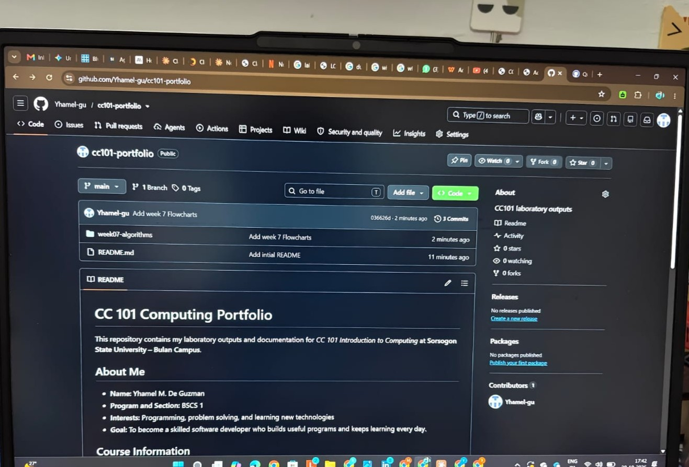

# CC 101 Computing Portfolio

This repository contains my laboratory outputs and documentation for *CC 101 Introduction to Computing* at **Sorsogon State University – Bulan Campus**.

## About Me

- **Name:** Yhamel M. De Guzman
- **Program and Section:** BSCS 1
- **Interests:** Programming, problem solving, and learning new technologies
- **Goal:** To become a skilled software developer who builds useful programs and keeps learning every day.

## Course Information

| Item | Details |
| --- | --- |
| Course | CC 101 Introduction to Computing |
| Instructor | John Mart D. Gabrentina |
| Academic Year | 2026–2027 |

## Portfolio Contents

1. [Week 7 – Pseudocode and Flowcharts](week07-algorithms/)
2. More activities will be added each week.

## Sample Pseudocode: Decimal to Binary

```
START
  DISPLAY "Enter a whole number (0 or greater): "
  INPUT n
  SET binary = ""
  IF n = 0 THEN
    SET binary = "0"
  ELSE
    WHILE n > 0 DO
      SET remainder = n MOD 2
      SET n = n DIV 2
      SET binary = remainder + binary
    ENDWHILE
  ENDIF
  DISPLAY "Binary: ", binary
END
```

## My Workspace



---

*Last updated: 2026-10-20*
